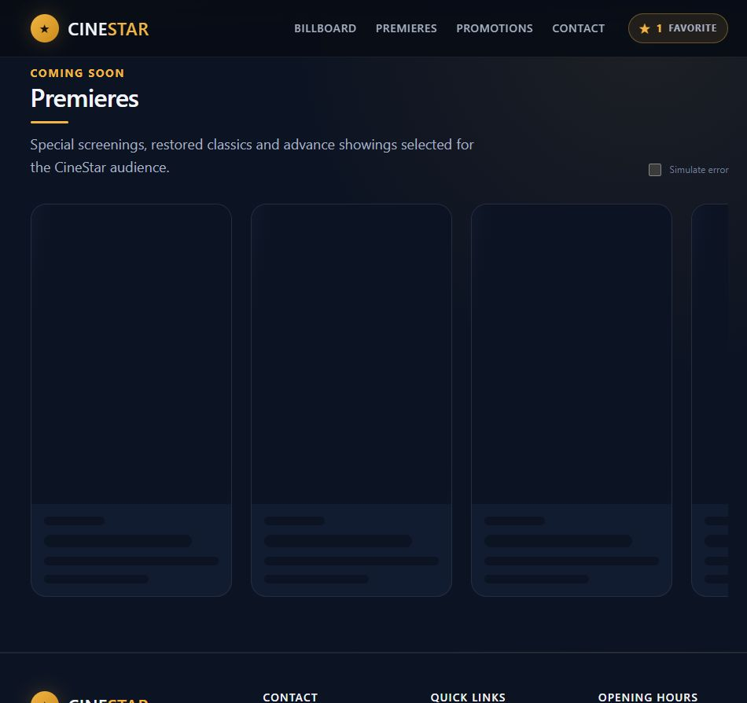
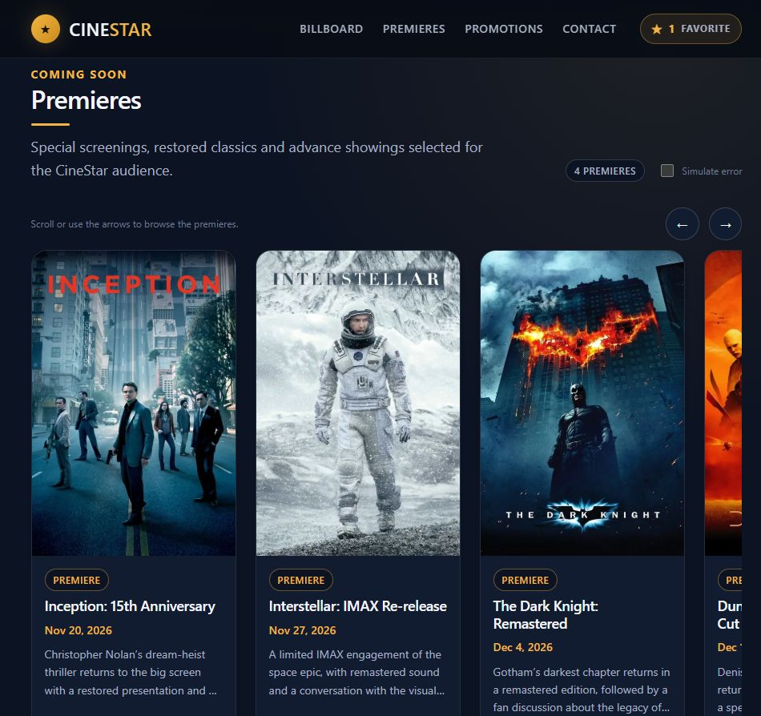
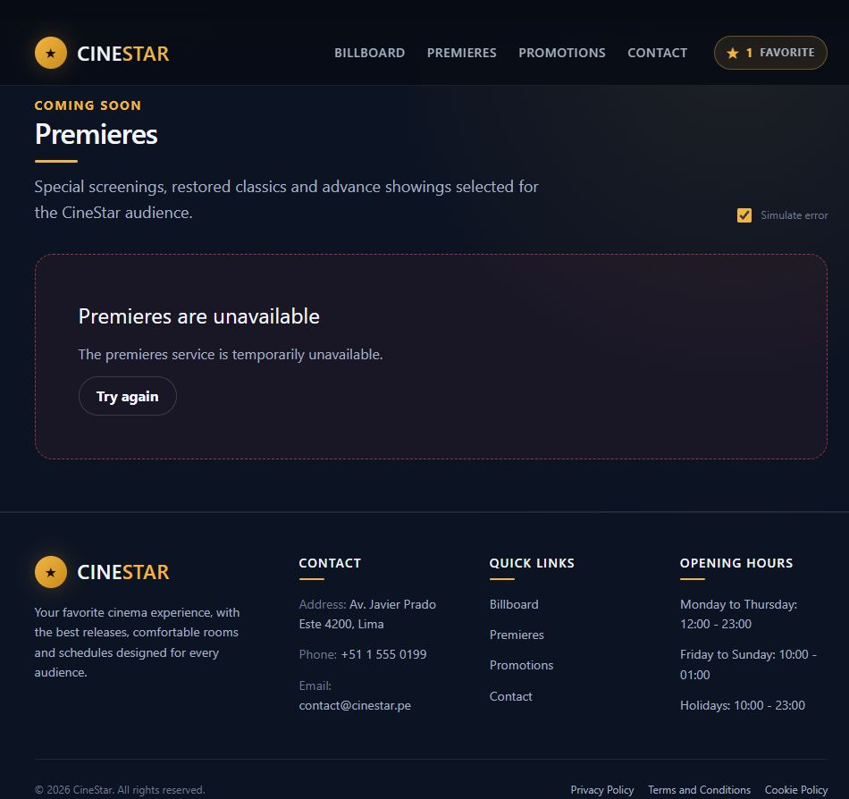
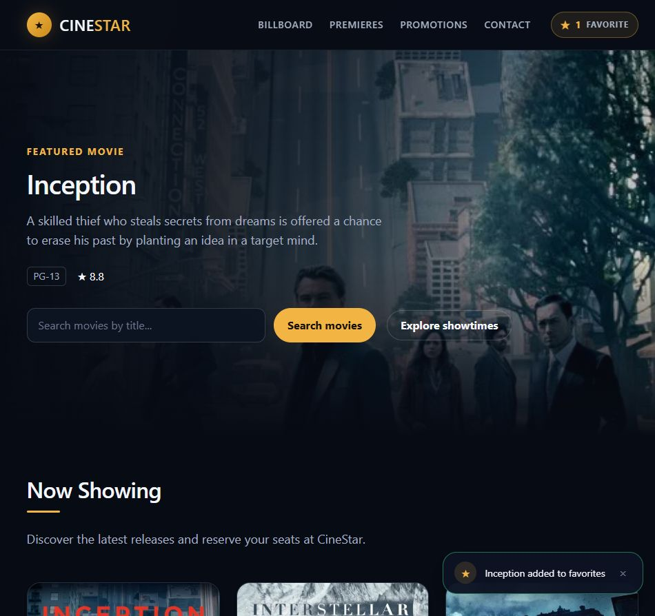

# Entregable — Laboratorio 10: hooks propios, adaptador y nueva interfaz

**Proyecto:** CineStar — Laboratorio 10  
**Repositorio:** <https://github.com/Ian1709/Lab09_Desarrollo_Empresarial>  
**Rama de trabajo:** `lab10/hooks-adapter-ui`  
**Stack:** React 19, Vite 8, CSS y Oxlint

Este documento registra la ampliación de la cartelera de CineStar con un
adaptador de datos, avisos emergentes, tres hooks propios, una sección de
estrenos con esqueleto y carrusel, el contador de favoritas en la cabecera y la
acción para limpiar el filtro. Además, explica el árbol de componentes, el dato
que vive en cada nivel y por qué el contador no puede vivir dentro de `Header`.

---

## 1. Punto de partida y rama de trabajo

Se partió de la cartelera terminada en el Laboratorio 9, publicada en `main`
hasta el commit `a8af108` (favoritas persistentes, buscador controlado, filtrado
y estado vacío). Antes de modificar código se comprobó que el proyecto levantara
y compilara.

La sesión se desarrolló en una rama propia para no alterar `main` mientras se
trabajaba:

```bash
git switch -c lab10/hooks-adapter-ui
```

Cada paso importante se registró en un commit independiente (ver sección 13).

---

## 2. Resumen de lo implementado

| # | Tarea | Implementación | Archivos principales |
| --- | --- | --- | --- |
| 1 | Rama de trabajo | `lab10/hooks-adapter-ui` creada desde `main` | — |
| 2 | Tipografía y utilidades nuevas | Escala `--font-size-4xl`, `--font-mono`, utilidades de texto, layout, superficie y `badge` | `src/styles/App.css` |
| 3 | Patrón adaptador | `adaptMovie`/`adaptMovies` traducen el payload externo al modelo de la UI | `src/utils/movieAdapter.js`, `src/data/movies.js` |
| 4 | Aviso emergente al marcar favoritas | Estado del toast en `App`; `MovieCard` solo notifica el clic | `src/components/Toast.jsx`, `src/App.jsx` |
| 5 | Hook `useDebounce` | Sustituye el retardo escrito a mano en el buscador | `src/hooks/useDebounce.js` |
| 6 | Hook `useWindowSize` | Decide cuántas tarjetas se muestran por fila | `src/hooks/useWindowSize.js`, `MovieList.jsx` |
| 7 | Hook `usePremieres` | Simula la petición y expone `loading`, `success` y `error` con `retry` | `src/hooks/usePremieres.js`, `src/services/premieresService.js` |
| 8 | Esqueleto y carrusel de estrenos | Sección que monta el hook y dibuja cada estado | `PremieresSection.jsx`, `PremieresSkeleton.jsx`, `PremieresCarousel.jsx`, `PremiereCard.jsx` |
| 9 | Contador de favoritas en la cabecera | `App` calcula el número y `Header` solo lo recibe | `src/App.jsx`, `src/components/Header.jsx` |
| 10 | Botón para limpiar el filtro | Acción en el banner que vacía el texto y sincroniza el listado | `src/components/Hero.jsx`, `src/App.jsx` |
| 11 | Documentación | Este entregable con el árbol de componentes y las decisiones | `docs/ENTREGABLE_LAB10.md` |
| 12 | Publicación | Commits por paso y push de la rama al repositorio del equipo | Rama `lab10/hooks-adapter-ui` |

---

## 3. Árbol de componentes y dato que vive en cada nivel

```text
App                                  ★ estado propio: favoriteIds, searchTerm, toast
│                                    ★ derivados: favoriteCount, cardsPerRow
├── Header                           ○ sin estado · prop: favoriteCount (número)
├── Hero                             ○ sin estado · props: movie, searchTerm,
│   │                                  onSearchChange, onSearchSubmit, onClearSearch
│   ├── MovieSearch                  ○ sin estado · props: value, onChange, onSubmit
│   └── Button ×2                    ○ sin estado · props: variant, onClick / href
├── main
│   ├── section#billboard
│   │   └── MovieList                ○ sin estado · props: movies, favoriteIds,
│   │       │                          searchTerm (ya retardado), cardsPerRow,
│   │       │                          onToggleFavorite
│   │       │                        ★ derivado en render: visibleMovies
│   │       └── MovieCard            ○ sin estado · props: movie, isFavorite,
│   │           │                      onToggleFavorite
│   │           └── Button           ○ sin estado · props: variant, aria-pressed, onClick
│   └── PremieresSection             ★ estado propio: simulateError (solo DEV)
│       │                            ◇ hook: usePremieres → status, data, error, retry
│       ├── PremieresSkeleton        ○ sin estado · prop opcional: count
│       ├── PremieresCarousel        ○ sin estado · prop: premieres
│       │   ├── Button ×2            ○ sin estado · flechas del carrusel
│       │   └── PremiereCard         ○ sin estado · prop: premiere (ya adaptada)
│       └── Panel de error           ○ sin estado · props: error, retry
├── Footer                           ○ sin estado
└── Toast                            ○ sin estado · props: message, tone, onDismiss
```

Los hooks no son componentes: su estado interno vive en el componente que los
invoca.

```text
useDebounce   (invocado en App)               ★ estado interno: debouncedValue
useWindowSize (invocado en App)               ★ estado interno: { width, height }
usePremieres  (invocado en PremieresSection)  ★ estado interno: result, attempt
```

### 3.1 Dato que vive en cada nivel

| Nivel | Dato que vive ahí | Origen / motivo |
| --- | --- | --- |
| `App` | `favoriteIds` | Única fuente de verdad de las favoritas; se inicializa desde `localStorage` y se persiste al cambiar. |
| `App` | `searchTerm` | Texto inmediato del buscador; lo comparten `Hero` (input) y `MovieList` (filtro). |
| `App` | `favoriteCount` | Valor derivado de `favoriteIds.length`; se pasa como número a `Header`. |
| `App` | `toast` | Mensaje y tono del aviso; se genera al marcar o desmarcar una favorita. |
| `App` | `useWindowSize` | Hook que expone el ancho de la ventana; de él se deriva `cardsPerRow`. |
| `useDebounce` | `debouncedValue` (interno) | Copia estabilizada de `searchTerm`; evita filtrar en cada pulsación. |
| `usePremieres` | `status`, `data`, `error`, `attempt` (interno) | Ciclo de vida de la petición de estrenos; `attempt` fuerza el reintento. |
| `PremieresSection` | `simulateError` | Solo en desarrollo: activa el estado de error para revisarlo. |
| `MovieList` | `visibleMovies` (derivado) | Se calcula en el render a partir de `movies` y `searchTerm`; no se guarda en estado. |
| `MovieCard` | Ningún estado | Dibuja `isFavorite` y llama a `onToggleFavorite(movie.id)`. |
| `Header` | Ningún estado | Recibe el número ya calculado; no conoce la lista ni los callbacks. |
| `localStorage` | Favoritas guardadas | Persistencia externa bajo la clave `cinestar.favoriteMovieIds`. |

Regla aplicada: **el estado mínimo indispensable vive en `App`; lo demás se
deriva durante el render o se encapsula en un hook**. Ningún componente guarda
una copia de un dato que ya vive en un ancestro.

---

## 4. Tipografía y utilidades nuevas

La hoja de estilos se amplió sin reemplazar los tokens existentes:

- Escala tipográfica adicional: `--font-size-4xl` y familia monoespaciada
  `--font-mono` para datos numéricos.
- Utilidades de texto: `.text-uppercase`, `.text-nowrap`, `.text-balance`,
  `.font-display`, `.font-numeric` y `.lead`.
- Utilidades de layout: `.stack`, `.stack--sm`, `.stack--lg`, `.cluster`,
  `.cluster--between`, `.section-header` y `.section-header__content/actions`.
- Utilidades visuales: `.surface` y `.badge`.

Los estilos se aplicaron a los componentes nuevos (sección de estrenos,
carrusel, esqueleto y contador). Los componentes del Laboratorio 9 se revisaron
en el navegador y conservaron su aspecto: cabecera, banner, tarjetas, buscador,
botones y pie de página.

---

## 5. Patrón adaptador

El modelo que consumen los componentes (`id`, `title`, `image`, `synopsis`,
`classification`, `rating`, `schedules`, `releaseDate`) no coincide con la forma
en que un servicio externo entrega los datos (`movieId`, `posterUrl`, `overview`,
`ageRating`, `voteAverage`, `showtimes`). Para evitar que ese detalle se filtre
a la interfaz se creó `src/utils/movieAdapter.js`:

```js
function adaptMovie(rawMovie = {}) {
  return {
    id: rawMovie.movieId ?? rawMovie.id,
    title: rawMovie.title ?? rawMovie.name ?? 'Untitled movie',
    image: rawMovie.posterUrl ?? rawMovie.image ?? '',
    synopsis: rawMovie.overview ?? rawMovie.synopsis ?? '',
    classification:
      rawMovie.ageRating ?? rawMovie.classification ?? 'NR',
    rating: Number(rawMovie.voteAverage ?? rawMovie.rating ?? 0),
    schedules: normalizeSchedules(rawMovie.showtimes ?? rawMovie.schedules),
    releaseDate: rawMovie.releaseDate ?? null,
  }
}
```

`src/data/movies.js` exporta el payload crudo como `movieCatalog` y el modelo
adaptado como `movies`. `App` solo importa `movies`; no conoce los nombres del
servicio externo. `PremieresSection` reutiliza el mismo adaptador a través de
`premieresService.js`.

Beneficios:

- Un único punto de traducción: si cambia el servicio, se ajusta el adaptador.
- `rating` siempre es numérico y `schedules` siempre es un arreglo de textos no
  vacíos, aunque el origen traiga `null`, números o elementos vacíos.
- Los componentes no contienen condicionales defensivos sobre el formato de la
  API.

---

## 6. Aviso emergente sin acoplar la tarjeta

El requisito era que `MovieCard` no supiera cómo se muestra el mensaje.
Solución: el estado del aviso vive en `App`, que ya es dueño de `favoriteIds`.

```jsx
const toggleFavorite = (movieId) => {
  const movie = movies.find((item) => item.id === movieId)
  const wasFavorite = favoriteIds.includes(movieId)

  setFavoriteIds((currentIds) =>
    currentIds.includes(movieId)
      ? currentIds.filter((id) => id !== movieId)
      : [...currentIds, movieId],
  )

  if (!movie) return

  setToast({
    id: Date.now(),
    message: wasFavorite
      ? `${movie.title} removed from favorites`
      : `${movie.title} added to favorites`,
    tone: wasFavorite ? 'info' : 'success',
  })
}
```

`MovieCard` sigue recibiendo `movie`, `isFavorite` y `onToggleFavorite`; no
importa `Toast` ni recibe props del aviso. `App` renderiza `<Toast>` fuera del
flujo de la cartelera, con `role="status"`, `aria-live="polite"`, cierre manual y
cierre automático a los 2.8 s. El `key={toast?.id}` reinicia el temporizador
cuando se dispara un aviso nuevo.

Flujo completo: clic en la tarjeta → `MovieCard` llama a `onToggleFavorite(id)`
→ `MovieList` reenvía la función de `App` → `App` actualiza favoritas y toast →
la tarjeta recibe el nuevo `isFavorite` y el aviso aparece sin que la tarjeta
sepa nada de él.

---

## 7. Hook `useDebounce`

```js
function useDebounce(value, delay = 400) {
  const [debouncedValue, setDebouncedValue] = useState(value)

  useEffect(() => {
    const timeoutId = window.setTimeout(() => setDebouncedValue(value), delay)
    return () => window.clearTimeout(timeoutId)
  }, [value, delay])

  return debouncedValue
}
```

Se eliminó `useDebouncedValue` y `App` ahora usa:

```js
const debouncedSearchTerm = useDebounce(searchTerm, 400)
```

El hook cancela el temporizador anterior cada vez que cambia el valor, de modo
que una ráfaga de pulsaciones solo aplica el último texto. `MovieList` recibe el
valor estabilizado, mientras que el input sigue mostrando `searchTerm` para
responder de inmediato. El retardo se mantuvo en 400 ms, igual que en el
Laboratorio 9.

---

## 8. Hook `useWindowSize`

```js
const { width } = useWindowSize()
const cardsPerRow = getCardsPerRow(width)
```

El hook escucha `resize` con `{ passive: true }`, actualiza un estado con
`{ width, height }` y retira el listener al desmontarse. En `App` se traduce el
ancho a columnas:

| Ancho de ventana | Tarjetas por fila |
| --- | --- |
| `>= 1280 px` | 4 |
| `>= 960 px` | 3 |
| `>= 640 px` | 2 |
| `< 640 px` | 1 |

`MovieList` aplica el valor con la variable CSS `--cards-per-row`, de modo que
la cuadrícula cambia sin duplicar media queries en JavaScript y CSS.

---

## 9. Hook `usePremieres`: tres estados reales

`src/services/premieresService.js` simula una petición de red de 900 ms.
Resuelve con los estrenos ya adaptados o rechaza si `shouldFail` es `true`;
también respeta un `AbortSignal` para cancelar el temporizador si el componente
se desmonta.

`src/hooks/usePremieres.js` encapsula el ciclo de vida:

```js
const requestKey = `${attempt}:${simulateError}`

// …
return { status, data, error, retry }
```

- `status: 'loading'` mientras la petición está en curso.
- `status: 'success'` con `data` adaptada.
- `status: 'error'` con `error` legible y acción `retry`.

Detalles de implementación:

- Cada resultado se etiqueta con el `requestKey` que lo produjo. Si el usuario
  reintenta o cambia el simulador, el resultado anterior deja de coincidir y el
  hook devuelve `loading` inmediatamente, sin un `setState` síncrono dentro del
  efecto (eso también mantiene limpio el lint).
- `retry` incrementa `attempt`, lo que vuelve a ejecutar el efecto.
- La limpieza del efecto aborta la petición anterior, evitando actualizaciones
  de estado sobre respuestas obsoletas.

`PremieresSection` monta el hook y dibuja un estado por vez. En desarrollo
incluye una casilla **Simulate error** para revisar el estado de error sin
depender de fallos reales del servicio.

---

## 10. Esqueleto y carrusel de estrenos

- `PremieresSkeleton` dibuja cuatro tarjetas fantasma con la misma estructura
  que las reales, animación `shimmer` y un texto `Loading premieres…` para
  lectores de pantalla (`role="status"`).
- `PremieresCarousel` usa `scroll-snap`, controla el desplazamiento con dos
  botones accesibles (`Previous premieres` / `Next premieres`) y respeta
  `prefers-reduced-motion` para elegir `smooth` o `auto`.
- `PremiereCard` muestra póster, insignia, título, fecha de estreno formateada,
  sinopsis recortada, clasificación y valoración.
- El estado de error muestra título, mensaje del servicio y botón **Try again**
  dentro de un contenedor `role="alert"`.

Estados comprobados en el navegador:

| Estado | Evidencia observada |
| --- | --- |
| Cargando | 4 esqueletos y texto `Loading premieres…`; 0 tarjetas reales |
| Con datos | 4 tarjetas, insignia `4 premieres`, flechas del carrusel operativas |
| Error | `Premieres are unavailable`, mensaje del servicio, `role="alert"` |
| Reintento | Vuelve a `loading` y luego a `success`; al desactivar el simulador se recupera solo |

Capturas en `docs/evidence/`:







---

## 11. Contador de favoritas: por qué no puede vivir en `Header`

`App` calcula el número y lo pasa como una prop numérica:

```jsx
const favoriteCount = favoriteIds.length
// …
<Header favoriteCount={favoriteCount} />
```

`Header` solo lo muestra, con `aria-live="polite"` y una etiqueta como
`1 favorite movie`:

```jsx
function Header({ favoriteCount = 0 }) {
  // …
  <p className="favorite-counter" aria-live="polite" aria-label={…}>
    <span aria-hidden="true">★</span>
    <span className="font-numeric">{favoriteCount}</span>
  </p>
}
```

Flujo del dato, desde la tarjeta hasta la cabecera:

```text
MovieCard                  MovieList                    App                     Header
    │  onToggleFavorite(id)    │                          │                        │
    ├─────────────────────────▶│  onToggleFavorite(id)    │                        │
    │                          ├─────────────────────────▶│                        │
    │                          │      setFavoriteIds      │                        │
    │                          │                          │ favoriteCount = length │
    │                          │                          ├───────────────────────▶│
    │                          │                          │    (solo el número)    │
```

**Por qué el contador no puede vivir en la cabecera:**

1. **`Header` no es el ancestro común.** Las acciones que modifican las
   favoritas ocurren en `MovieCard`, dentro de `MovieList`. Si `Header` fuera
   dueño de la lista, tendría que pasar el estado y los callbacks hacia abajo por
   `Hero`/`MovieList`/`MovieCard` (prop drilling) y volver a subir cada clic,
   duplicando el camino que ya existe hacia `App`.
2. **Habría dos fuentes de verdad.** `App` necesita `favoriteIds` para
   persistirlas, filtrar identificadores válidos y notificar el toast. Si
   `Header` mantuviera otra copia, ambas podrían desincronizarse tras una
   recarga o un cambio hecho en otra parte de la interfaz.
3. **La cabecera es presentacional.** `Header` no conoce películas, ni
   `localStorage`, ni la forma de la lista; solo debe dibujar navegación y un
   resumen. Recibir un número mantiene bajo su acoplamiento y facilita
   reutilizarlo.
4. **El dato correcto ya está elevado.** `App` es el nivel mínimo que puede
   compartir el estado entre la cabecera y las tarjetas, y además es donde vive
   la persistencia. Elevar solo el número (no la lista completa) cumple el
   requisito sin exponer detalles innecesarios.

Comparación concreta:

| Si el contador viviera en `Header` | Con el diseño actual |
| --- | --- |
| `Header` necesitaría `favoriteIds` y `toggleFavorite`, o habría que mover allí el estado y bajar la lista por `Hero` y `MovieList`. | `App` conserva la lista y los callbacks; `Header` recibe solo `favoriteCount`. |
| La persistencia en `localStorage` tendría que duplicarse o moverse a la cabecera. | La persistencia sigue en un único `useEffect` de `App`. |
| Un clic en una tarjeta no actualizaría la cabecera sin elevar el evento hasta `App` y volver a bajarlo. | `App` actualiza `favoriteIds` y el nuevo número llega a `Header` en el mismo render. |
| `Header` dejaría de ser un componente de presentación y dependería del dominio de películas. | `Header` sigue siendo reutilizable y solo muestra un resumen. |
| Tras una recarga, la lista de `Header` y la de `App` podrían divergir. | Solo hay una fuente de verdad, por lo que no hay divergencia posible. |

En resumen: **la lista vive donde se modifica y se persiste (`App`); la cabecera
recibe únicamente el dato derivado que necesita mostrar.**

Evidencia del contador y del aviso:



---

## 12. Botón para limpiar el filtro

`Hero` recibe `onClearSearch` y muestra el botón solo cuando hay texto:

```jsx
const hasActiveFilter = searchTerm.trim().length > 0
// …
{hasActiveFilter && (
  <Button variant="ghost" className="hero__clear" onClick={onClearSearch}>
    Clear filter
  </Button>
)}
```

`App` implementa la acción vaciando el único estado del buscador:

```js
const handleClearSearch = () => {
  setSearchTerm('')
}
```

Como el input es controlado y `MovieList` consume el valor retardado:

1. El botón vacía `searchTerm`.
2. El input se limpia en el mismo render.
3. `useDebounce` propaga el valor vacío tras 400 ms.
4. `MovieList` vuelve a mostrar las ocho películas y desaparece el resumen de
   búsqueda.
5. El botón se oculta porque ya no hay filtro activo.

Se comprobó en el navegador: con `dune` se mostraba 1 de 8 películas y el botón;
al pulsarlo, el input quedó vacío, reaparecieron las 8 tarjetas y el resumen
desapareció. El buscador, el botón y el listado siguen sincronizados porque
todos leen el mismo estado de `App`.


---

## 13. Verificación técnica

| Comprobación | Resultado |
| --- | --- |
| `npm run build` | Compila correctamente: 36 módulos transformados, sin errores |
| `npm run lint` | Oxlint termina sin advertencias ni errores |
| Adaptador | 8 películas adaptadas; `id`, `rating` y `schedules` con el tipo esperado |
| Toast al marcar | `Inception added to favorites`, `role="status"` |
| Toast al desmarcar | `Inception removed from favorites`, tono informativo |
| Contador | Pasa de 1 a 0 y de 0 a 1 al alternar la favorita; etiqueta accesible correcta |
| `useDebounce` | El filtro se aplica 400 ms después de la última pulsación |
| `useWindowSize` | Con 965 px de ancho se renderizan 3 columnas (`data-cards-per-row="3"`) |
| Estrenos | Esqueleto → 4 tarjetas → error → reintento → recuperación |
| Limpiar filtro | `dune` → 1 tarjeta; al limpiar → 8 tarjetas e input vacío |
| Responsive | La cuadrícula cambia de columnas según el ancho de ventana |

---

## 14. Commits de esta etapa

| Commit | Contenido |
| --- | --- |
| `style(lab10): extend typography scale and shared utilities` | Tokens, utilidades de texto, layout, superficie y badge |
| `feat(lab10): add movie adapter and normalize billboard payload` | Adaptador, catálogo crudo y modelo adaptado |
| `feat(lab10): show toast notifications when toggling favorites` | `Toast`, estado en `App` y estilos |
| `feat(lab10): replace ad-hoc delay with reusable useDebounce hook` | Hook `useDebounce` y sustitución del retardo manual |
| `feat(lab10): add useWindowSize and responsive cards per row` | Hook, columnas calculadas y variable CSS |
| `feat(lab10): add usePremieres hook with loading, success and error states` | Datos, servicio simulado y hook |
| `feat(lab10): add premieres skeleton, carousel and section using usePremieres` | Componentes de estrenos, estilos y montaje |
| `feat(lab10): lift favorite count to App and show it in Header` | Contador derivado y cabecera accesible |
| `feat(lab10): add clear-filter action to the hero banner` | Botón, variante `ghost` y sincronización |
| `docs(lab10): add deliverable with component tree and screenshots` | Este documento, README y evidencias |

El historial puede revisarse con:

```bash
git log --oneline --decorate
```

---

## 15. Conclusiones

1. **Una sola fuente de verdad simplifica toda la interfaz.** Mantener
   `favoriteIds` en `App` y derivar `favoriteCount` permitió que las tarjetas y
   la cabecera reflejen siempre el mismo estado sin duplicarlo. `Header` recibe
   solo un número, lo que demuestra que el estado compartido debe elevarse al
   ancestro común y no vivir en un componente presentacional.

2. **Los hooks propios encapsulan lógica y hacen explícitos los estados.**
   `useDebounce`, `useWindowSize` y `usePremieres` separaron temporizadores,
   eventos del navegador y peticiones del render de los componentes. En
   particular, `usePremieres` modela `loading`, `success` y `error` con
   `retry`, lo que convirtió el esqueleto, el carrusel y el mensaje de error en
   casos previsibles y comprobables.

3. **El adaptador protege la interfaz de los cambios del origen de datos.**
   `movieAdapter` centralizó la traducción de `movieId`, `posterUrl`,
   `showtimes`, `ageRating` y `voteAverage` al modelo interno. Así los
   componentes no conocen el formato externo y reciben datos normalizados
   (valoración numérica y horarios válidos), lo que reduce condicionales y
   facilita sustituir la fuente de datos en el futuro.

4. **La retroalimentación y la accesibilidad completan la funcionalidad.**
   El toast con `aria-live`, el contador con etiqueta accesible, el esqueleto
   con `role="status"`, el error con `role="alert"` y el botón de limpiar filtro
   sincronizado hacen que la aplicación comunique lo que ocurre y sea usable con
   teclado y lector de pantalla. Documentar el árbol de componentes y el dato de
   cada nivel dejó explícito el diseño y facilita su mantenimiento.

En conjunto, el laboratorio muestra que un diseño cuidadoso del estado y de las
responsabilidades de cada componente aporta más que la cantidad de código.

---

## 16. Alcance y siguientes pasos

La aplicación sigue siendo un prototipo frontend con datos locales y un servicio
de estrenos simulado: no hay backend real, autenticación ni pruebas
automatizadas. Las favoritas se guardan por navegador, no por usuario.

Como siguientes pasos se podrían agregar pruebas de los hooks con Vitest y
Testing Library, un servicio real de estrenos con caché, un panel de favoritas
con la lista completa, filtros por clasificación o género y la sincronización de
las favoritas con una cuenta de usuario.
